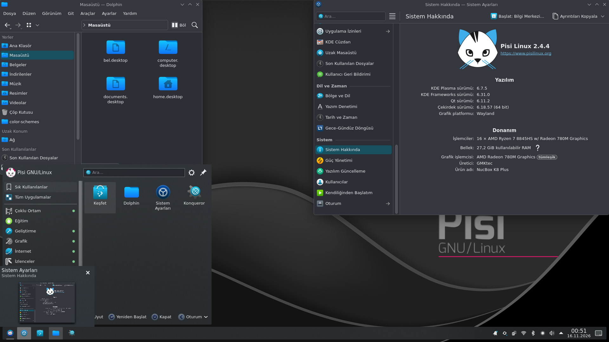

# Pisi Linux Dark

[Türkçe](README.md) · **English**

A dark desktop theme for KDE Plasma 6. It brings the Pisi Linux identity to the Plasma desktop: dark grey surfaces with a turquoise accent, packaged together with the wallpaper, color scheme, splash screen, lock screen, and logout screen.



## What's included

The repository keeps the install paths intact (`usr/share/...`), so it can be copied by hand or consumed as-is by packagers.

| Component | Path |
|---|---|
| Plasma desktop theme | `usr/share/plasma/desktoptheme/pisilinux-dark/` |
| Look-and-Feel package | `usr/share/plasma/look-and-feel/pisilinux-dark/` |
| Color scheme (`PisilinuxDark.colors`) | `usr/share/color-schemes/` |
| Wallpaper (2.4.4, 1280x1024 – 3840x2160) | `usr/share/wallpapers/pisilinux-2.4.4-wallpaper/` |

### Desktop theme

`widgets/` holds the SVGZ artwork for Plasma components (panel background, buttons, scrollbars, task manager, tooltips, list items, tab bar, media delegate, and more). `dialogs/` contains the dialog background.

### Look-and-Feel package

Defaults defined in `contents/defaults`, applied in one pass:

- **Color scheme:** `PisilinuxDark`
- **Window decoration:** Breeze
- **Widget style:** Breeze
- **Icon theme:** Kora
- **Cursor theme:** Mevlana
- **Wallpaper:** Pisi Linux 2.4.4

### Screens

- **Splash screen:** `contents/splash/` — Pisi Linux background with the animated `Pisi.gif` logo.
- **Lock screen:** `contents/lockscreen/` — `LockScreen.qml`, `LockScreenUi.qml`, `MainBlock.qml`, `ChangeSession.qml`, and `LockOsd.qml`. The background is loaded from the packaged `lockscreen/background.png`.
- **Logout screen:** `contents/logout/` — rewritten against the Plasma 6 API using Breeze components: `Logout.qml`, `LogoutButton.qml`, and `timer.js` for the countdown. The selected action fires after a 30-second countdown by default.
- **Previews:** `contents/previews/` — `preview.png`, `lockscreen.png`, and `splash.png` as shown in System Settings.
- **Others:** `osd/`, `runcommand/`, `userswitcher/`, `windowswitcher/`, and `desktopswitcher/` are built on Breeze layouts with Pisi Linux artwork.

### Color palette

| Role | Color |
|---|---|
| Accent / selection | `#1F9CCB` (turquoise) |
| Window background | `#34383E` |
| View background | `#2C3036` |
| Button background | `#4A4E55` |
| Normal text | `#E8EAED` |
| Link | `#6DB2D6` |
| Negative / positive / neutral | `#E06E6E` / `#7EC88C` / `#E0B25C` |

## Repository layout

```
usr/share/
├── color-schemes/PisilinuxDark.colors
├── plasma/
│   ├── desktoptheme/pisilinux-dark/     # Plasma desktop theme (SVGZ)
│   └── look-and-feel/pisilinux-dark/    # Global theme, splash, lock and logout screens
└── wallpapers/pisilinux-2.4.4-wallpaper/
```

## Requirements

- KDE Plasma 6 (the theme uses `X-Plasma-API 5.0`, Look-and-Feel uses `X-Plasma-APIVersion 2`)
- `plasma-workspace` for the `org.kde.plasma.private.sessions` module used by the lock and logout screens
- Breeze Look-and-Feel components (`org.kde.breeze.components`) and the Breeze window decoration
- Optional, for the full look: the `kora` icon theme and the `Mevlana` cursor theme

## Installation

### System-wide

```sh
sudo cp -r usr /
```

Then restart Plasma or log out and back in:

```sh
kquitapp6 plasmashell && kstart plasmashell
```

### Per-user

```sh
mkdir -p ~/.local/share
cp -r usr/share/plasma ~/.local/share/
cp -r usr/share/color-schemes ~/.local/share/
cp -r usr/share/wallpapers ~/.local/share/
```

### Enabling the theme

In **System Settings → Appearance**:

1. **Global Theme:** pick `pisilinux-dark` and apply. This pulls in the color scheme, wallpaper, splash, and lock screen.
2. **Colors:** `PisilinuxDark`
3. **Plasma Style:** `Pisi Linux Dark`
4. **Splash Screen:** `pisilinux-dark`
5. **Wallpaper:** `pisilinux 2.4.4`

To try only the color scheme from the command line:

```sh
plasma-apply-colorscheme PisilinuxDark
```

Or to apply the whole global theme:

```sh
lookandfeeltool -a pisilinux-dark
```

## Uninstallation

```sh
sudo rm -rf /usr/share/plasma/desktoptheme/pisilinux-dark \
            /usr/share/plasma/look-and-feel/pisilinux-dark \
            /usr/share/color-schemes/PisilinuxDark.colors \
            /usr/share/wallpapers/pisilinux-2.4.4-wallpaper
```

If you installed per-user, remove the same paths under `~/.local/share`.

## Release notes

- Removed the invalid `components/artwork/background.png` reference in the lock screen; the background now loads from the packaged `lockscreen/background.png`.
- Replaced the Plasma 5 based logout screen with a Plasma 6 compatible implementation built on Breeze components (`Logout.qml`, `LogoutButton.qml`, `timer.js`).
- Updated the preview images (`preview.png`, `lockscreen.png`).

## Packaging notes

Because the repository preserves the `usr/` root layout, it can be installed by extracting over `/`. For `pspec.xml`/`actions.py` based packaging on Pisi Linux, copy the `usr/` tree as-is into `$install_dir` and keep the version fields in the `metadata.json` files in sync with the package version.

## Credits

- **Erkan İŞİK** — theme maintenance, color scheme, and Plasma 6 port (`erkanisik@pisilinux.org`)
- **Smokey** — the work the Look-and-Feel package was derived from
- **Murat Özgün** — Pisi Linux 2.4.4 wallpaper

## License

The root `LICENSE` file contains the **GNU GPL v3** text. The desktop theme and the Look-and-Feel package are marked GPLv3, and the wallpaper is marked LGPLv3. For redistribution, follow the license declared in each component's `metadata.json`.

The logout screen QML files are derived from the KDE Breeze project and are licensed under `GPL-2.0-or-later`; the SPDX headers at the top of each file are preserved.
