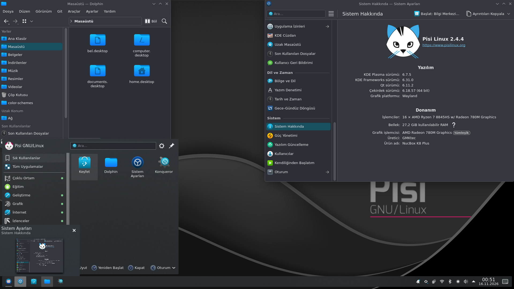

# Pisi Linux Dark

KDE Plasma 6 için hazırlanmış koyu renkli masaüstü teması. Pisi Linux'un kurumsal kimliğini Plasma masaüstüne taşıyan tema; koyu gri tonları üzerine turkuaz vurgu rengi kullanır ve duvar kağıdı, renk şeması, açılış (splash) ekranı, kilit ekranı ve oturum kapatma ekranlarını tek bir pakette birleştirir.



## İçerik

Depo, dosyaları doğrudan yerleşim yollarıyla (`usr/share/...`) içerir; böylece hem elle kopyalanabilir hem de paketleyiciler tarafından olduğu gibi kullanılabilir.

| Bileşen | Yol |
|---|---|
| Plasma masaüstü teması | `usr/share/plasma/desktoptheme/pisilinux-dark/` |
| Görünüm ve his (Look-and-Feel) paketi | `usr/share/plasma/look-and-feel/pisilinux-dark/` |
| Renk şeması (`PisilinuxDark.colors`) | `usr/share/color-schemes/` |
| Duvar kağıdı (2.4.4, 1280x1024 – 3840x2160) | `usr/share/wallpapers/pisilinux-2.4.4-wallpaper/` |

### Masaüstü teması

`widgets/` altında Plasma bileşenlerinin (panel arka planı, düğmeler, kaydırma çubukları, görev çubuğu, araç ipuçları, liste öğeleri, sekme çubuğu, medya denetleyicisi vb.) SVGZ grafikleri bulunur. `dialogs/` altında ise iletişim kutularının arka planı yer alır.

### Görünüm ve his paketi

Tek seferde tutarlı bir görünüm kuran varsayılanlar:

- **Renk şeması:** `PisilinuxDark`
- **Pencere dekorasyonu:** Breeze
- **Araç takımı (widget) stili:** Breeze
- **Simge teması:** Kora
- **İmleç teması:** Mevlana
- **Duvar kağıdı:** Pisi Linux 2.4.4
- **Açılış ekranı:** Pisi logosu ve animasyonlu `Pisi.gif` içeren özel splash
- **Kilit ekranı, oturum kapatma ekranı, OSD ve pencere değiştirici:** Breeze düzenleri üzerine Pisi Linux görselleri

### Renk paleti

| Rol | Renk |
|---|---|
| Vurgu / seçim | `#1F9CCB` (turkuaz) |
| Pencere arka planı | `#34383E` |
| Görünüm arka planı | `#2C3036` |
| Düğme arka planı | `#4A4E55` |
| Normal metin | `#E8EAED` |
| Bağlantı | `#6DB2D6` |
| Negatif / pozitif / nötr | `#E06E6E` / `#7EC88C` / `#E0B25C` |

## Gereksinimler

- KDE Plasma 6 (tema `X-Plasma-API 5.0` ve Look-and-Feel `X-Plasma-APIVersion 2` kullanır)
- Breeze araç takımı ve pencere dekorasyonu
- Tam görünüm için isteğe bağlı: `kora` simge teması, `Mevlana` imleç teması

## Kurulum

### Sistem geneli

```sh
sudo cp -r usr /
```

Ardından Plasma'yı yeniden başlatın veya oturumu kapatıp açın:

```sh
kquitapp6 plasmashell && kstart plasmashell
```

### Yalnızca kullanıcı için

```sh
mkdir -p ~/.local/share
cp -r usr/share/plasma ~/.local/share/
cp -r usr/share/color-schemes ~/.local/share/
cp -r usr/share/wallpapers ~/.local/share/
```

### Etkinleştirme

**Sistem Ayarları → Görünüm** bölümünden:

1. **Genel Görünüm (Global Theme):** `pisilinux-dark` seçip uygulayın. Renk şeması, duvar kağıdı, splash ve kilit ekranı birlikte gelir.
2. **Renkler:** `PisilinuxDark`
3. **Masaüstü Teması:** `Pisi Linux Dark`
4. **Açılış Ekranı:** `pisilinux-dark`
5. **Duvar Kağıdı:** `pisilinux 2.4.4`

Tek tek uygulamak yerine yalnızca renk şemasını denemek için:

```sh
plasma-apply-colorscheme PisilinuxDark
```

veya

```sh
lookandfeeltool -a pisilinux-dark
```

## Kaldırma

```sh
sudo rm -rf /usr/share/plasma/desktoptheme/pisilinux-dark \
            /usr/share/plasma/look-and-feel/pisilinux-dark \
            /usr/share/color-schemes/PisilinuxDark.colors \
            /usr/share/wallpapers/pisilinux-2.4.4-wallpaper
```

Kullanıcıya özel kurulum yaptıysanız aynı yolları `~/.local/share` altında silin.

## Paketleme notları

Depo, `usr/` kök yapısını koruduğu için `/` dizinine açılarak kurulabilir. Pisi Linux için `pspec.xml`/`actions.py` tabanlı paketleme yapılacaksa `usr/` ağacı olduğu gibi `$install_dir` içine kopyalanmalı, `metadata.json` dosyalarındaki sürüm alanları paket sürümüyle eşitlenmelidir.

## Katkıda bulunanlar

- **Erkan İŞİK** — tema bakımı, renk şeması ve Plasma 6 uyarlaması (`erkanisik@pisilinux.org`)
- **Smokey** — Look-and-Feel paketinin temel aldığı çalışma
- **Murat Özgün** — Pisi Linux 2.4.4 duvar kağıdı

## Lisans

Depo kökündeki `LICENSE` dosyası **GNU GPL v3** metnini içerir. Masaüstü teması ve Look-and-Feel paketi GPLv3, duvar kağıdı LGPLv3 olarak işaretlenmiştir. Yeniden dağıtımda ilgili bileşenin `metadata.json` dosyasındaki lisansı esas alın.
